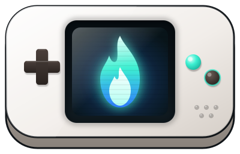

  

<h1 align="center">NoriDeck</h1>

  
  
  
  

  
  
  
  

<pre>
NoriDeck
========

A retro handheld-style software console that plays game cartridges (.nori)
written in TypeScript. Games are built as separate .nori cartridge files; the
console stores and runs them and takes care of screen ratio, key mapping,
saves and game speed.
This document covers using the console. To make cartridges or contribute to
the console, see <a href="CONTRIBUTING.md">CONTRIBUTING.md</a>.

Install
-------

  Download from <a href="https://github.com/NGHSLab/NoriDeck/releases">Releases</a>.

  NoriDeck Setup x.y.z.exe        : Windows installer. Lets you pick the install
                                    folder and adds Start menu and desktop
                                    shortcuts plus an uninstaller
  NoriDeck x.y.z.exe              : Windows portable, no install. Create a
                                    norirepo folder next to it and games and saves
                                    are stored there (for USB drives)
  NoriDeck-x.y.z-linux-x64.tar.gz : Linux preview. Extract it and run
                                    norideck

  The app is not code-signed yet, so Windows SmartScreen warns on first
  launch. Click "More info -&gt; Run anyway".

  Windows is the primary platform; Linux is a preview. On distributions where
  it fails with a sandbox error (Ubuntu 24.04 and later, for example), run this
  once in the extracted folder:
    sudo chown root:root chrome-sandbox
    sudo chmod 4755 chrome-sandbox

Getting started
---------------

  1. Launch NoriDeck. The home screen starts empty, showing only the console
     icon.
  2. Drag a .nori file onto the window, or choose File -&gt; Add cartridge. It is
     added to your library and its cover card appears on the home screen.
  3. Click Play on the card, or click the cover (Enter on the keyboard), to
     start the game.
  4. With more than one cartridge, page through them with the arrow buttons,
     the Left/Right keys or the mouse wheel.

  Need a cartridge to try? Grab snake-x.y.z.nori from Releases and drop it in.

While playing
-------------

  Go home (pause) : P, or File -&gt; Home. The game stays paused in the
                    background and its card shows the last frame
  Resume          : Click that card on the home screen, or press P again
  Quit the game   : Card gear menu -&gt; Close game. Starting another
                    cartridge also closes it
  Speed           : Tab (toggles x1 &lt;-&gt; your fast-forward speed,
                    default x3)
  Fullscreen      : F11
  Window size     : View -&gt; Window scale x0.5 / x1 / x1.5

  Only one game can stay paused in the background at a time.

Default controls
----------------

  D-pad                : W A S D (arrow keys also work)
  A / B                : H / J
  X / Y                : K / L
  L / R                : Y / U
  SELECT / START       : I / O
  Home (game &lt;-&gt; home) : P
  Speed toggle         : Tab
  Fullscreen           : F11

  Change any button under Config -&gt; Controls. Click a slot around the console
  drawing, then press a key; it saves right away (Esc cancels). A key binds to
  one place only. Tab and F11 are reserved by the console and cannot be
  changed.

Settings (Config menu)
----------------------

  Language
    Switch the console UI between English and Korean. The
    in-game language is up to each cartridge.

  Controls
    Change the keys in the table above.

  Volume
    Set the master volume with a slider (0 = mute). Applies
    as you move it and is shared by all cartridges.

  Fast-forward speed
    Choose the Tab speed: x1.5, x2, x3 or x4.

  Open games folder / Open data folder
    Open the folders that hold cartridges and saves.

Managing cartridges and saves
-----------------------------

  Use the gear button on a card (or right-click, or K on the keyboard).

  Info             : Title, version, author, SDK, screen size, import
                     date, last played
  Open folder      : Open this cartridge's folder
  Export cartridge : Save the stored .nori elsewhere under its
                     original name
  Back up saves    : Save all save slots into one zip
  Restore saves    : Pick a backup zip and overwrite (shows the slots
                     to be overwritten first)
  Delete saves     : Delete all of this cartridge's saves
  Remove           : Remove from the library. Saves are kept, so you
                     can pick up where you left off after importing
                     it again

Where things are stored
-----------------------

  %APPDATA%\norideck\games\&lt;cartridge id&gt;\
    cart.nori          imported cartridge file
    meta.json          info for the library list
    cover.png          cover (if any)
    saves\&lt;slot&gt;.json  saves

  In portable mode (norirepo folder) the same layout lives inside that folder.
  One cartridge is one folder, so copying that folder backs up the game and
  its saves together.

Troubleshooting
---------------

  Closes right after launching
    NoriDeck is already running. Only one instance runs at a time
    and the existing window comes to the front.

  "Cannot run cartridge" after adding one
    The file is damaged (checksum mismatch) or the cartridge does
    not match the console's SDK version. The red message at the
    bottom of the home screen gives the reason.

  A paused card shows the cover instead of the last frame
    Cartridges that draw with WebGL cannot have their last frame
    captured, so the cover is shown instead. Resuming works normally.

  Keys do nothing in the game
    Check the layout under Config -&gt; Controls and try "Reset to
    defaults". Keys do not reach the game while a menu or dialog
    is open.

Making cartridges / contributing
--------------------------------

  Cartridges are written in TypeScript and packed into a single .nori file with
  the nori CLI. Start with the command below. Even without coding experience,
  open the folder in an AI coding tool and it will read the included AGENTS.md
  and build the cartridge for you.
    npm create nori@latest my-cart

  Cartridge development guide : <a href="docs/cartridge-guide.md">docs/cartridge-guide.md</a>
  Contributing to the console : <a href="CONTRIBUTING.md">CONTRIBUTING.md</a>

License
-------

  Source code is under the MIT License. See <a href="LICENSE">LICENSE</a>.
  Credits for fonts, icons and other third-party material are in <a href="CREDITS.md">CREDITS.md</a>.
</pre>
